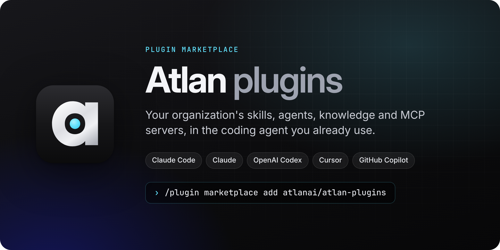
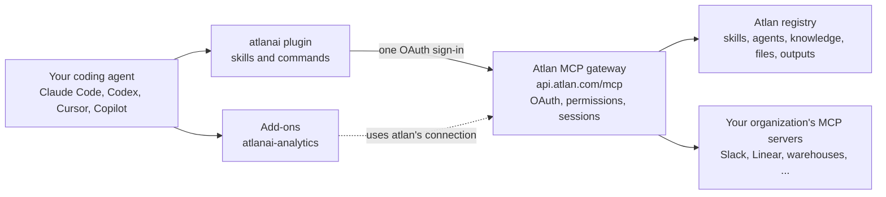

<p align="center">
  
</p>

<p align="center">
  <a href="https://github.com/atlanai/atlan-plugins/actions/workflows/ci.yml"></a>
  <a href="LICENSE"></a>
  <a href="https://agent-plugins.org"></a>
</p>

<p align="center">
  <a href="https://platform.atlan.com/">Docs</a> ·
  <a href="#install">Install</a> ·
  <a href="#plugins">Plugins</a> ·
  <a href="#what-you-can-ask">What you can ask</a> ·
  <a href="#how-it-works">How it works</a> ·
  <a href="#privacy-and-security">Privacy and security</a> ·
  <a href="CONTRIBUTING.md">Contributing</a>
</p>

# Atlan plugins

Atlan's plugin marketplace for coding agents. Install it once and your agent can reach your
organization's Atlan registry: the skills, agents, knowledge and MCP servers your teams have
already published. It can find what fits the task, use it in the current project, and publish
new work back, all under your own sign-in.

## Install

You need an account in an Atlan organization. You sign in through your browser with OAuth, so
there is no API key to create or paste.

**One command, every coding agent on this machine** (Node.js 18 or later):

```
npx plugins add atlanai/atlan-plugins
```

It finds Claude Code, Codex, Cursor, GitHub Copilot CLI, VS Code and the other agents the
[`plugins`](https://github.com/vercel-labs/plugins) installer supports, and installs `atlanai`
and `atlanai-analytics` into each through its own plugin system. Then sign in once per agent:

| Agent | Sign in |
|---|---|
| Claude Code | `/mcp`, pick `plugin:atlanai:atlan`, **Authenticate** |
| Codex | Prompted when installed from inside Codex; after `codex plugin add`, run `codex mcp login atlan` |
| Cursor | **Settings**, **Tools & MCP**, connect `atlan` |
| VS Code and Copilot | Start the `atlan` server when prompted |

Then type: *"Connect me to Atlan."* In Claude Code,
`/atlanai:get-started` does the same.

### Or install for one agent

| Agent | Install |
|---|---|
| [Claude Code](https://code.claude.com) | `claude plugin install atlanai --marketplace atlanai/atlan-plugins` |
| [OpenAI Codex](https://openai.com/codex/) | `codex plugin marketplace add atlanai/atlan-plugins`, then `codex plugin add atlanai@atlan` and `codex mcp login atlan` |
| [Claude](https://claude.ai) chat and Cowork | **Customize**, **Plugins**, **Add marketplace**: `atlanai/atlan-plugins`; add **AI Registry**, then **Connect** on its **Connectors** tab |
| [Cursor](https://cursor.com) | Import `atlanai/atlan-plugins` as a team marketplace, or install **AI Registry** from the Cursor Marketplace |
| [VS Code with GitHub Copilot](https://code.visualstudio.com/docs/copilot/overview) | Add `atlanai/atlan-plugins` to `chat.plugins.marketplaces`, then install **AI Registry** from Chat Plugins |
| Skills only, any Agent Skills tool | `npx skills add atlanai/atlan-plugins` (no MCP server; add `--skill <name>` to pick one) |
| MCP server only, any MCP client | `https://api.atlan.com/mcp` (Streamable HTTP with OAuth), for example `claude mcp add --transport http atlan https://api.atlan.com/mcp` |

For the analytics add-on, install `atlanai-analytics` the same way. Claude Code installs
`atlanai` with it; every other agent needs `atlanai` installed first. Inside a running Claude
Code session, type the install as `/plugin install …` and then `/reload-plugins`.

On Claude Team and Enterprise plans, an Owner first adds the connector
`https://api.atlan.com/mcp` for the organization. The
[install and sign-in guide](plugins/atlanai/skills/atlan-get-started/references/install-and-sign-in.md)
covers each agent in detail.

> **Not the `atlan` plugin in Anthropic's directory.** `/plugin install atlan` installs Atlan's
> data catalog plugin (atlanhq/agent-toolkit), a different product on a different server. This
> marketplace's plugin is `atlanai`, and the two can be installed side by side.

## Plugins

| Plugin | What it adds |
|---|---|
| [**AI Registry**](plugins/atlanai) (`atlanai`) | Atlan's remote MCP server and the skills to find, use and publish what is in the registry. Every other plugin here builds on it. |
| [**Analytics**](plugins/atlanai-analytics) (`atlanai-analytics`) | Answers data questions from your managed metrics, mines your warehouse's query history into metrics and saved SQL queries, and builds, evaluates and improves a talk-to-data agent on them. Works with Snowflake, Databricks or another warehouse. |
| [**Registry Mods**](plugins/atlanai-mods) (`atlanai-mods`) | Claude Code only. Registry reads run without a prompt, writes ask first, and an archive or move shows what depends on the artifact. Fixes misplaced session ids and rationales, Shows each Atlan call as one readable line, lists what the session read and changed in a pane, follows a skill publish in a band above the prompt, and picks a skill to load with `/atlan skills`. Reports a broken connection on the status line. |

### AI Registry

The core plugin connects one MCP server, `atlan`, and teaches your agent when to use it.

| Skill | Use it to |
|---|---|
| `atlan-get-started` | Check the connection, learn how calls work, and find the right skill |
| `atlan-find-artifacts` | Search skills, agents, knowledge, MCP servers, files and outputs |
| `atlan-use-skill` | Run a registry skill now, or install it in this project |
| `atlan-use-mcp-servers` | Call Slack, Linear or any other server registered in Atlan, or register a new one |
| `atlan-manage-artifacts` | Archive, move, deprecate, roll back or approve an artifact, showing what depends on it first, and see what waits for review |
| `atlan-continue` | Pick up an artifact handed over from the Atlan dashboard |
| `atlan-troubleshoot` | Diagnose sign-in errors, refusals, conflicts, rate limits and failed uploads |
| `atlan-content` | Write, upload, read or append files in the registry |
| `atlan-author-skills` | Create a skill in Atlan or publish a new version |
| `atlan-author-agents` | Register an agent or harness, link a repository's agent, or update one |
| `atlan-author-knowledge` | Publish knowledge to Atlan, or update it |
| `atlan-connect-repo` | Record where a skill came from, or sync a repository's skills from GitHub |
| `atlan-record-outputs` | Record what a run produced as an Atlan output |
| `atlan-share` | Share a result with your team through Atlan, and post the hand-off to Slack |

In Claude Code and Cursor, the commands `/atlanai:get-started`, `/atlanai:use-skill <skill_…>`,
`/atlanai:continue <output_…>` and `/atlanai:share` run `atlan-get-started`, `atlan-use-skill`,
`atlan-continue` and `atlan-share`; those four skills hide their own slash entries, so each task is
listed once. `/atlanai:feedback` drafts feedback for Atlan and leaves sending it to you. In Codex, the plugin
runs `atlan-get-started` right after install, which offers to check Atlan for a fitting skill
at the start of each task: on a yes it adds a short, marked note to `~/.codex/AGENTS.md`, and
"stop checking Atlan for skills" removes it. In Claude Code, Registry Mods does the same. Run
`codex plugin marketplace upgrade atlan` to take a new version in Codex.

### Registry Mods

A [mod](https://code.claude.com/docs/en/plugins/mods/overview) for Claude Code v2.1.287 or later:
TypeScript that runs inside Claude Code and changes how it treats the `atlan` server's tools.
Install it with `claude plugin install atlanai-mods --marketplace atlanai/atlan-plugins`. Other
agents do not load mods, and every skill works without it. See its
[README](plugins/atlanai-mods) for what it calls and how organizations that allow only managed
mods deploy it.

### Analytics

An add-on for the analytics workload. It uses the core plugin's connection and declares no MCP
server of its own, so no Atlan tool appears twice. It finds your warehouse through Atlan or a
connector you already have, and asks you to connect one when it is missing. Building and
evaluating an agent uses Claude Code or the existing isolated Claude/Codex runner. See its [README](plugins/atlanai-analytics) for the full
list of skills and agents.

New metric runs use the owned metrics module with its original input plugs, readers,
authoring gates and verification. The plugin drives the interview and keeps its existing
Registry publication flow. See [the module boundaries and setup](docs/metrics-module.md).

## What you can ask

These work in any host once you are signed in.

| Ask | What happens |
|---|---|
| *"Show my organization's skills and agents in Atlan."* | Lists what your workspaces hold |
| *"Find an Atlan skill for writing release notes and use it here."* | Searches the registry, then loads the best match into the session |
| *"Post a summary of this PR to our team's Slack channel through Atlan."* | Calls an MCP server your organization registered in Atlan, under your permissions |
| *"Share this report with the platform team and post it in #platform-eng."* | Records it in the team's workspace, versioned on each share, and posts the hand-off to Slack after you approve the post |
| *"Publish the skill in this folder to Atlan."* | Bundles the folder, uploads it and creates a new version |
| *"Sync this repository's skills to Atlan from GitHub."* | Sets up GitHub-to-Atlan sync for the repository |
| *"Why did my last Atlan call fail?"* | Reads the error and the session record, and says what to fix |
| *"What was revenue last quarter, by region, from our published metrics?"* | With Analytics: answers from a managed metric and names the definition it used |

## How it works



The `atlan` server runs Atlan's MCP gateway in search mode. Three tools (`mcp__search_tools`,
`mcp__describe_tools` and `mcp__call_tool`) reach the registry's own tools, every Atlan app's
tools and every MCP server your organization registered; connecting your account for one of
those servers runs through `mcp__call_tool` as `mcp__connect_server`. The agent
searches for the tool it needs instead of loading hundreds of schemas up front. Atlan checks
your permissions on each call and records it in a session you can review.

The skills are plain Markdown. They teach the agent which tools to call and in what order,
and point at live tools instead of copying reference data that would go stale.

## Privacy and security

- **Little runs on your machine.** The add-ons are Markdown files: no hooks, no binaries, no
  local storage. `atlanai` adds one hook, the publish helper, in Claude Code, Codex and Cursor
  (in Codex and Cursor only once you trust its hooks, and only where `python3` is installed):
  when the agent publishes a skill with `files_from`, it reads that one folder in your working
  tree, refuses links, credential files and folders, and anything outside the tree, and sends
  the files only in that same call to Atlan. It can also load one digest-bound local JSON batch
  of metrics or saved queries into an Atlan bulk-create call, under the same path, credential
  and size checks. When Analytics requests receipt recording, it saves native results as
  immutable private run files and small tool-id mappings in `.atlan-receipt-pending/`.
  The same hook reads
  `atlanai`'s public manifest on `main` at session start, so the agent can tell you once when an
  update is out (`ATLAN_PLUGIN_UPDATE_CHECK=0` turns it off), and in Claude Code may offer to
  draft feedback after a failed Atlan call (`DO_NOT_TRACK=1` turns it off). Feedback is shown to
  you and sent by you, never by a hook. `atlanai-mods` is code
  that runs inside Claude Code; its [README](plugins/atlanai-mods) lists every call it makes.
- **Your sign-in, your permissions.** Every call carries your own OAuth sign-in, and Atlan
  enforces your organization's permissions on it. The plugins hold no credentials.
- **Every call is recorded.** Atlan keeps each call in a session you can review in the
  dashboard.
- **One identifying header.** Requests carry `X-Atlan-Client: atlan-plugin/<version>`, so
  Atlan can tell a session came from this plugin.

See Atlan's [privacy notice](https://atlan.com/privacy-policy/). To report a vulnerability, see
[SECURITY.md](SECURITY.md).

## Troubleshooting

- **Atlan skills appear twice.** The Atlan desktop app installs its own copy of `atlanai`, from
  another marketplace, or the `atlan` server was also added by hand. Keep one.
- **The Atlan tools are about search, lineage and glossaries.** That is the data catalog plugin
  named `atlan` from Anthropic's directory, a different product. Install `atlanai` beside it.
- **The add-on says the Atlan tools are missing.** Outside Claude Code, install `atlanai` first,
  then sign in to its server.
- **Upgrading from 0.2 or earlier.** The plugins were named `atlan` and `atlan-analytics`.
  Uninstall them (`claude plugin uninstall atlan@atlan-plugins`, and the same for
  `atlan-analytics`), then install `atlanai`. Slash commands move from `/atlan:` to `/atlanai:`.
- **Installed from the `atlan-plugins` marketplace.** The marketplace is now named `atlan`.
  Remove the old one (`claude plugin marketplace remove atlan-plugins` in Claude Code) and
  install again.
- **A call is refused or fails.** Ask your agent to use `atlan-troubleshoot`. It reads the
  error and says whether to sign in again, ask for access or retry.

## Repository layout

```
.claude-plugin/marketplace.json   the marketplace, for Claude and Claude Code
.agents/plugins/marketplace.json  the same marketplace, for Codex
.cursor-plugin/marketplace.json   the same marketplace, for Cursor
plugins/<name>/                   one folder per plugin: manifests, skills, commands and agents
plugin.toml                       the source of every manifest
tools/                            the build and lint, and their tests
```

Every plugin is a folder under `plugins/`, the layout Anthropic's
[official marketplace](https://github.com/anthropics/claude-plugins-official) and OpenAI's
[plugins](https://github.com/openai/plugins) use. A workload built on the registry ships as its
own plugin, named `atlanai-<workload>`. A Claude Code mod ships the same way, as `atlanai-mods`.

## Contributing

Issues and pull requests are welcome. Read [CONTRIBUTING.md](CONTRIBUTING.md) to set up and run
the checks, and [AGENTS.md](AGENTS.md) for the layout rules, variants and releases. Everyone
taking part follows the [code of conduct](CODE_OF_CONDUCT.md).

## License

[Apache-2.0](LICENSE). Atlan and the Atlan logo are trademarks of Atlan; the license does not
grant rights to them.
