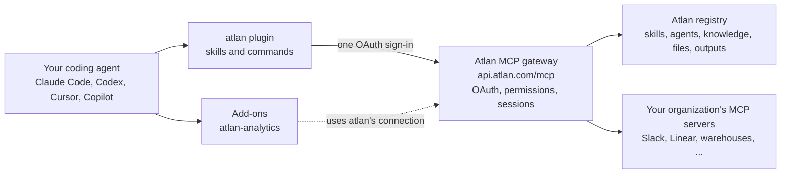

<p align="center">
  
</p>

<p align="center">
  <a href="https://github.com/atlanai/atlan-plugins/actions/workflows/ci.yml"></a>
  <a href="LICENSE"></a>
  <a href="https://agent-plugins.org"></a>
</p>

<p align="center">
  <a href="#install">Install</a> ·
  <a href="#plugins">Plugins</a> ·
  <a href="#what-you-can-ask">What you can ask</a> ·
  <a href="#how-it-works">How it works</a> ·
  <a href="#privacy-and-security">Privacy and security</a> ·
  <a href="CONTRIBUTING.md">Contributing</a>
</p>

# Atlan plugins

Atlan's plugin marketplace for coding agents. Install it once and your agent can reach your
organization's Atlan registry: the skills, agents, knowledge and MCP servers your teams have
already published. It can find what fits the task, use it in the current project, and publish
new work back, all under your own sign-in.

The same marketplace installs in every major agent host:

| Host | Install from | Status |
|---|---|---|
| [Claude Code](https://code.claude.com) | `/plugin marketplace add` | Supported, installs dependencies |
| [Claude](https://claude.ai) chat and Cowork | **Customize → Plugins** | Supported |
| [OpenAI Codex](https://openai.com/codex/) | `codex plugin marketplace add` | Supported |
| [Cursor](https://cursor.com) | Cursor Marketplace or team marketplace | Supported |
| [VS Code with GitHub Copilot](https://code.visualstudio.com/docs/copilot/overview) and other [Agent Plugins](https://agent-plugins.org) hosts | `chat.plugins.marketplaces` | Supported |
| Any MCP client | `https://api.atlan.com/mcp` | MCP server only, no skills |

## Install

You need an account in an Atlan organization. You sign in through your browser with OAuth, so
there is no API key to create or paste.

### Claude Code

```
/plugin marketplace add atlanai/atlan-plugins
/plugin install atlan@atlan-plugins
/plugin install atlan-analytics@atlan-plugins    # optional; installs atlan too
```

Then run `/mcp`, pick `plugin:atlan:atlan` and choose **Authenticate**. Check the connection
with `/atlan:get-started`.

<details>
<summary><b>Claude chat and Cowork</b></summary>

In Claude, go to **Customize**, **Plugins**, **Add**, **Add marketplace** and enter
`atlanai/atlan-plugins`. Add **Atlan**, then click **Connect** on its **Connectors** tab.

On Team and Enterprise plans, an Owner first adds the connector `https://api.atlan.com/mcp`
for the organization.

</details>

<details>
<summary><b>OpenAI Codex</b></summary>

```
codex plugin marketplace add atlanai/atlan-plugins
codex plugin add atlan@atlan-plugins
codex plugin add atlan-analytics@atlan-plugins   # optional
```

</details>

<details>
<summary><b>Cursor</b></summary>

Install **Atlan** from the Cursor Marketplace, or import `atlanai/atlan-plugins` as a team
marketplace. Then connect the `atlan` server under **Settings**, **Tools & MCP**.

</details>

<details>
<summary><b>VS Code with GitHub Copilot</b></summary>

Add `atlanai/atlan-plugins` to the `chat.plugins.marketplaces` setting, then install **Atlan**
from the Chat Plugins section of the Extensions view.

</details>

<details>
<summary><b>Skills only, or the MCP server only</b></summary>

`npx skills add atlanai/atlan-plugins` copies the skills without the MCP server. Add
`--skill <name>` to pick one.

To use the MCP server without any skills, point an MCP client at `https://api.atlan.com/mcp`
(Streamable HTTP with OAuth). For example:

```
claude mcp add --transport http atlan https://api.atlan.com/mcp
```

</details>

Only Claude Code installs a plugin's dependencies. In every other host, install `atlan` before
any other plugin from this marketplace. The
[install and sign-in guide](plugins/atlan/skills/atlan-get-started/references/install-and-sign-in.md)
covers each host in detail.

Once you are signed in, try: *"Connect to Atlan and show me which skills my organization has."*

## Plugins

| Plugin | What it adds |
|---|---|
| [**Atlan**](plugins/atlan) (`atlan`) | Atlan's remote MCP server and the skills to find, use and publish what is in the registry. Every other plugin here builds on it. |
| [**Atlan Analytics**](plugins/atlan-analytics) (`atlan-analytics`) | Answers data questions from your governed metrics, mines your warehouse's query history into metrics and saved SQL queries, and builds, evaluates and improves a talk-to-data agent on them. Works with Snowflake, Databricks or another warehouse. |

### Atlan

The core plugin connects one MCP server, `atlan`, and teaches your agent when to use it.

| Skill | Use it to |
|---|---|
| `atlan-get-started` | Check the connection, learn how calls work, and find the right skill |
| `atlan-find-artifacts` | Search skills, agents, knowledge, MCP servers, files and outputs |
| `atlan-use-skill` | Run a registry skill now, or install it in this project |
| `atlan-use-mcp-servers` | Call Slack, Linear or any other server registered in Atlan, or register a new one |
| `atlan-continue` | Pick up an artifact handed over from the Atlan dashboard |
| `atlan-troubleshoot` | Diagnose sign-in errors, refusals, conflicts, rate limits and failed uploads |
| `atlan-content` | Write, upload, read or append files in the registry |
| `atlan-author-skills` | Create a skill in Atlan or publish a new version |
| `atlan-author-agents` | Register an agent or harness, link a repository's agent, or update one |
| `atlan-author-knowledge` | Publish knowledge to Atlan, or update it |
| `atlan-connect-repo` | Record where a skill came from, or sync a repository's skills from GitHub |
| `atlan-record-outputs` | Record what a run produced as an Atlan output |

In Claude Code and Cursor, the commands `/atlan:get-started`, `/atlan:use-skill <skill_…>` and
`/atlan:continue <output_…>` run `atlan-get-started`, `atlan-use-skill` and `atlan-continue`. The Atlan dashboard's
**Open in Claude** buttons send the last two.

### Atlan Analytics

An add-on for the analytics workload. It uses the core plugin's connection and declares no MCP
server of its own, so no Atlan tool appears twice. It finds your warehouse through Atlan or a
connector you already have, and asks you to connect one when it is missing. Building and
evaluating an agent needs Claude Code. See its [README](plugins/atlan-analytics) for the full
list of skills and agents.

## What you can ask

These work in any host once you are signed in.

| Ask | What happens |
|---|---|
| *"Show my organization's skills and agents in Atlan."* | Lists what your workspaces hold |
| *"Find an Atlan skill for writing release notes and use it here."* | Searches the registry, then loads the best match into the session |
| *"Post a summary of this PR to our team's Slack channel through Atlan."* | Calls an MCP server your organization registered in Atlan, under your permissions |
| *"Publish the skill in this folder to Atlan."* | Bundles the folder, uploads it and creates a new version |
| *"Sync this repository's skills to Atlan from GitHub."* | Sets up GitHub-to-Atlan sync for the repository |
| *"Why did my last Atlan call fail?"* | Reads the error and the session record, and says what to fix |
| *"What was revenue last quarter, by region, from our published metrics?"* | With Atlan Analytics: answers from a governed metric and names the definition it used |

## How it works



The `atlan` server runs Atlan's MCP gateway in search mode. Four tools (`mcp__search_tools`,
`mcp__describe_tools`, `mcp__call_tool` and `mcp__connect_server`) reach the registry's own
tools, every Atlan app's tools and every MCP server your organization registered. The agent
searches for the tool it needs instead of loading hundreds of schemas up front. Atlan checks
your permissions on each call and records it in a session you can review.

The skills are plain Markdown. They teach the agent which tools to call and in what order,
and point at live tools instead of copying reference data that would go stale.

## Privacy and security

- **Nothing runs on your machine.** The plugins have no hooks, no binaries and no local
  storage. They are Markdown files and an MCP server URL.
- **Your sign-in, your permissions.** Every call carries your own OAuth sign-in, and Atlan
  enforces your organization's permissions on it. The plugins hold no credentials.
- **Every call is recorded.** Atlan keeps each call in a session you can review in the
  dashboard.
- **One identifying header.** Requests carry `X-Atlan-Client: atlan-plugin/<version>`, so
  Atlan can tell a session came from this plugin.

See Atlan's [privacy notice](https://atlan.com/privacy-policy/). To report a vulnerability, see
[SECURITY.md](SECURITY.md).

## Troubleshooting

- **Every Atlan tool appears twice.** The Atlan desktop app installs its own plugin, `atlanai`,
  which registers the same `atlan` server. Keep one of the two.
- **The add-on says the Atlan tools are missing.** Outside Claude Code, install `atlan` first,
  then sign in to its server.
- **A call is refused or fails.** Ask your agent to use `atlan-troubleshoot`. It reads the
  error and says whether to sign in again, ask for access or retry.

## Repository layout

```
.claude-plugin/marketplace.json   the marketplace, for Claude and Claude Code
.agents/plugins/marketplace.json  the same marketplace, for Codex
.cursor-plugin/marketplace.json   the same marketplace, for Cursor
plugins/<name>/                   one folder per plugin: manifests, skills, commands and agents
plugin.toml                       the source of every manifest
upstream.json                     pins for the skills taken from the registry's apps
tools/                            the build, sync and lint, and their tests
```

Every plugin is a folder under `plugins/`, the layout Anthropic's
[official marketplace](https://github.com/anthropics/claude-plugins-official) and OpenAI's
[plugins](https://github.com/openai/plugins) use. A workload built on the registry ships as its
own plugin, named `atlan-<workload>`.

## Contributing

Issues and pull requests are welcome. Read [CONTRIBUTING.md](CONTRIBUTING.md) to set up and run
the checks, and [AGENTS.md](AGENTS.md) for the layout rules, variants and releases. Everyone
taking part follows the [code of conduct](CODE_OF_CONDUCT.md).

## License

[Apache-2.0](LICENSE). Atlan and the Atlan logo are trademarks of Atlan; the license does not
grant rights to them.
