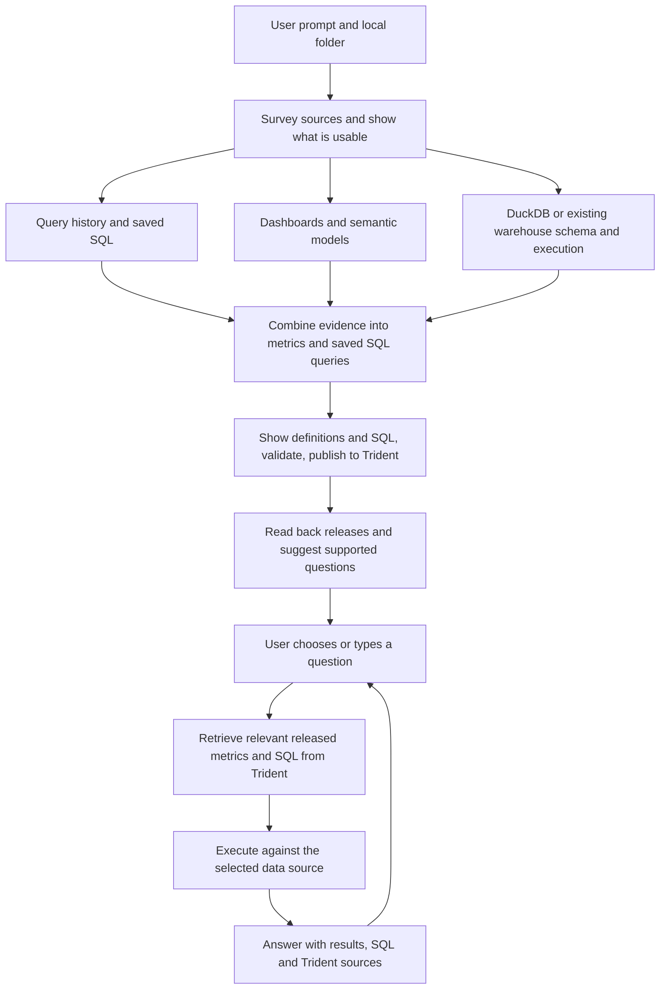

# Local repositories in the existing Atlan Analytics workflow

Plan revised 6 November 2026 for the simplified publish-and-ask scope. See the
[implementation and test report](local-estate-analytics-verification.md) for the current code,
measured results and remaining verification gaps.

## Decision

Extend the existing Analytics workflow in `atlanai/atlan-plugins`. The customer repository supplies data, reports, models and query history. Installed plugin code owns discovery, SQL execution, metric and saved-query authoring, Trident publication, retrieval and answers. The accelerator repository is one acceptance fixture for this general capability. It must not be required at runtime.

Keep the existing `start`, `dashboard`, `query-history`, `metrics`, `ask`, `build`, `eval`, `improve`, `connect` and ontology behavior. Add a repo-aware route to the current Analytics skill, with natural-language matching for “Set up this project so I can ask questions about its data: <folder>”. No new plugin, MCP server, separate application or cloned implementation repository is needed.

The current scope is prompt, survey, generate and publish context, suggest questions, then retrieve from Trident and answer in the current chat. Query history is a first-class source whenever it is available in the selected scope. DuckDB supplies schema and query execution; it is not the only source of business definitions.



Evals, new agent registration, deployment and Agent Usage verification are deferred from this new route. Keep the existing explicit build/eval/improve capabilities available. SQL/schema checks and honest publication status still apply; skipping evals does not make unexecuted SQL verified.

If the initial prompt already contains a business question, answer it after publication using Trident retrieval. Otherwise show three to five supported sample questions and let the user choose or type their own. Do not silently choose and run a sample. The conversational loop is user asks, plugin retrieves and executes, plugin answers, user follows up.

## Survey and publication contract

1. Survey the selected folder and already-authorized connections. Find downloaded reports, semantic models, rowset SQL, saved SQL, query-history exports, existing DuckDB files and reachable warehouse tools. Stay inside the supplied scope; exclude credential files and do not execute repository setup scripts.
2. Show a compact inventory with source, count, role, usability and any missing input. Distinguish business-definition evidence from data execution. A history export can be mined without a live warehouse login. A PBIT supplies definitions but cannot supply fresh data by itself.
3. Use every relevant available source in scope. With both model and history available, combine them without asking the user to choose one. Use exported history before requesting live history access. Missing history does not block model-led work; missing dashboards does not block history-led work.
4. Extract declared measures and mine history for additional measures, recurring questions, joins, dimensions and filters. Reconcile by meaning and provenance, retaining source evidence and material disagreements. Query frequency ranks candidates; it does not prove correctness. Do not treat every raw query or query shape as a separate metric.
5. Produce two linked artifact sets: `metric` definitions with formula, grain, units, dimensions, filters, time semantics and executable SQL; and `sql_query` artifacts with the business question, SQL, dialect, parameters, result shape, source tables, validation status and related metrics where supported by the live contracts. A useful detail query need not become an aggregate metric.
6. Show a counted preview of new, revised, reused and held items, with representative definitions and SQL and access to the complete inventory. Use the existing contract checks, execution checks, publication controls and recovery. Publish into the selected Trident workspace and read back the released revisions. Account for every scoped candidate; report unsupported or conflicting items instead of silently dropping them or claiming exhaustive discovery.

## Retrieval and question experience

Generate suggested questions from the just-published, usable definitions and queries. Link each suggestion to its supporting artifact releases and known dimensions. Use templates such as a total, a breakdown, a trend or a detail list only where that specific capability is supported. Do not suggest a time window without a defined date basis.

For each user question, use the existing `analytics-ask` route with the selected workspace and data binding. Search Trident for relevant `metric` and `sql_query` artifacts, retrieve the released bodies, and construct or reuse SQL from those definitions. Run fresh read-only SQL against the selected local database or warehouse, then show the answer, executed SQL and Trident source links/revisions. Local generation files and remembered setup answers cannot substitute for retrieval.

Retain the publication receipt and source binding across turns and fresh host sessions. Scope retrieval to the chosen workspace and applicable estate, prioritize the artifacts just published, and use another released artifact only when its semantics and execution binding fit. Never silently fall back to an unreleased local draft if retrieval fails. Explain missing context or execution access and preserve the usable work.

Definitions can be prepared without execution access, but their SQL remains untested. Numeric questions require a reachable data source. Publication success alone is not a successful answer.

## Baseline checked

- Linked Codex chat: `Research dashboard-to-data agents`. Its latest completed turn reports the first-answer, counted-coverage, scoped-selection and entry-point improvements as local and unpushed.
- Current checkout: `codex/dashboard-reliability`, HEAD `affa6d8aca883ca02f344458aa9e97767eb89441`, plus those uncommitted changes. They were inspected and left untouched.
- [PR 85](https://github.com/atlanai/atlan-plugins/pull/85) is still open, targeting Analytics 0.5.10. Do not assume this behavior is already installed for customers.
- `an internal repository` resolves to `atlanai/atlan-plugins`. The checked manifest and remote main currently package core `atlanai` and the existing `atlanai-analytics` add-on separately. A sentence in the Analytics skill also describes a bundled distribution. Verify the actual shipping manifest rather than relying on that sentence. Extend the existing Analytics source; if the product requires a core-only installation, expose that same maintained source through the existing build, without introducing a third plugin or a forked copy.

## What the supplied repository actually contains

The [accelerator yard](https://github.com/atlanai/analytics-agent-accelerator/tree/main/yard) has:

| Asset | Observed content | Role |
|---|---|---|
| `yard/data/*.csv` | Five physical tables; documented row counts 10 projects, 8 crew, 746 work logs, 51 material orders, 11 snags | Input data for a local warehouse |
| `yard/load.py` | Builds `yard/fixit.duckdb`; deletes that database first if it exists | Fixture setup only; not a customer ingestion contract |
| `yard/q.py` | Opens DuckDB read-only, accepts SQL starting with SELECT/WITH/DESCRIBE/SHOW, returns at most 50 rows | Fixture query helper; not a general execution boundary |
| `yard/powerbi/hard-hat-area-site-performance.pbit` | One report page, four semantic tables, four measures | Power BI report/model definitions |
| `yard/powerbi/model.bim` | The same readable model, including table partitions | Supporting semantic metadata, not another independent report |
| `yard/powerbi/rowsets.json` | SQL for the four semantic rowsets over five physical tables | Explicit transformation evidence |
| `yard/history/querylog.jsonl` | 110 normalized SQL records with execution and user counts | Candidate queries, dimensions and workload evidence |

The four measures are Gross Margin, Rework Cost, Material Waste and Late Jobs. The same source should not be counted twice because both a PBIT and a BIM exist. The DuckDB is generated locally, not committed in the inspected remote tree.

The template's M partitions name a Snowflake connection even though this requested run uses local DuckDB. Treat the embedded connection as source provenance. The user's explicit DuckDB binding selects execution. Never prompt for Snowflake merely because its connector appears in a downloaded model.

Power BI templates contain report, model and query definitions, but no imported dataset. Therefore this PBIT cannot independently supply numerical parity references. [Microsoft template documentation](https://learn.microsoft.com/en-us/power-bi/create-reports/desktop-templates).

## Reuse versus additions

| Capability | Current foundation | Required addition |
|---|---|---|
| Entry and resumption | Analytics mode dispatch, local `Run`, stage receipts | Repo discovery, local source identity, selected data binding and persisted original goal |
| Power BI metadata | Existing PBIX/PBIT/BIM parser and bounded DAX compiler | Local-file entry without a service URL; table partitions; supported result-type inference; per-measure unresolved status |
| Query history | Existing normalizer, privacy filtering and shape miner | Correct JSONL object intake; recognize already-normalized logs; mine alongside models and reconcile both metric and saved-query candidates |
| Data execution | Snowflake CLI integration and host warehouse tools | Native DuckDB adapter used consistently for SQL checks and fresh answers |
| Metrics and saved SQL | Native metric/query validation and Registry create/revise/reuse/recovery | Composable local definitions with dimensions, time semantics, joins, parameters, linked query artifacts and stable source IDs |
| Suggested questions | Existing first-answer and follow-up guidance | Derive suggestions from usable released artifacts and wait for the user's question when none was supplied |
| Retrieval and answers | Existing ask skill and released-definition lookup | Search and fetch Trident releases for each question; retain workspace, estate and local executor across turns and fresh-session resume |

Evals and agent tracing remain available in their existing explicit workflows but require no additions for this scope.

## Reproduced gaps

These probes used downloaded files from the specified repository and the current local plugin. They made no model calls, Registry writes or dependency installations.

1. **Local file cannot start a run.** Both an absolute PBIT path and its `file://` URI are refused by `source_link`. `Run.start` requires that function. [Source validation](../plugins/atlanai-analytics/skills/analytics-build/scripts/dashboard_runtime/trident/core.py), [run index](../plugins/atlanai-analytics/skills/analytics-build/scripts/dashboard_run.py).
2. **Metadata extraction succeeds, capture fails.** The actual PBIT yields one page, four tables and four measures. All four omit `dataType`; `capture_from_inventory` rejects the entire capture. The BIM produces the same issue. Derive types only for supported expressions with evidence, or retain an unknown per-measure state. Currency formatting alone is not a type proof. [Importer](../plugins/atlanai-analytics/skills/analytics-build/scripts/dashboard_runtime/trident/powerbi_file.py).
3. **Transformation evidence is dropped.** Four partitions exist under `model.tables[*].partitions`, but the parser reads `model.partitions` and emits zero partitions and zero Power Query entries for both actual files. Preserve the table association and expression without executing M. [Inspector](../plugins/atlanai-analytics/skills/analytics-build/scripts/dashboard_runtime/scripts/inspect_powerbi.py).
4. **DuckDB is not a supported compiler/executor choice.** All four expressions are refused with dialect `duckdb`. The schema lists Snowflake, Postgres and SQLite. Do not disguise DuckDB as SQLite. Add dialect-specific bindings and behavior. [Compiler](../plugins/atlanai-analytics/skills/analytics-build/scripts/dashboard_runtime/trident/dax_sql.py), [contracts](../plugins/atlanai-analytics/skills/analytics-build/scripts/dashboard_runtime/trident/contracts.py).
5. **Query-log re-normalization loses the input.** The export intake returns zero records for the actual JSONL because a per-line object is not recognized as a row. The existing direct JSONL reader accepts all 110; the shape miner produces 86 predicate-sensitive shapes in 38 families, 68 containing aggregates. These are query shapes, not 86 verified metrics. Fix intake and reuse the miner. [Normalizer](../plugins/atlanai-analytics/skills/analytics-build/scripts/metrics_mine.py).
6. **Local execution is guidance, not a completed interface.** The new dashboard/start instructions say to reuse a local adapter, but preflight only distinguishes Snowflake from a host-confirmed existing adapter. `connect.md` and the ask skill primarily find MCP tools and vendor CLIs; local binding is not a durable first-class route. [Preflight](../plugins/atlanai-analytics/skills/analytics-build/scripts/dashboard_preflight.py), [connect](../plugins/atlanai-analytics/skills/analytics-build/references/connect.md), [ask](../plugins/atlanai-analytics/skills/analytics-ask/SKILL.md).
7. **Fixed tile answers are too narrow for the promised analytical question.** `portable_metric` wraps the complete scalar query and declares no reaggregation. Keep this supported representation, but add composable metrics for verified grouping, time windows and joins. Gross-margin SQL here lacks a reporting-date column, so “last quarter” needs an explicit date policy and a proven join. The four tiles alone cannot establish all semantics for “Which job ate our margin last quarter, and what ate it?” [Metric adapter](../plugins/atlanai-analytics/skills/analytics-build/scripts/dashboard.py).
8. **Deferred finding: session publication is not Usage verification.** The existing eval documentation explicitly says spans remain empty and sessions appear in Sessions. The prior workshop rehearsal also observed no traces in Usage after ordinary chat. This is outside the simplified route. If the full agent journey is resumed later, measured agent-owned traces and exact Usage verification are still required. [Eval publishing](../plugins/atlanai-analytics/skills/analytics-build/references/eval.md), [smoke](../plugins/atlanai-analytics/skills/analytics-build/references/build/06-smoke.md).

The parser also requires the PBIXRay environment even for text-only BIM/PBIT metadata. Make dependencies capability-specific: use existing text parsing for text metadata and require the approved binary decoder only for binary models.

DuckDB was not installed in the Python interpreter used for this assessment. No queries against a built yard database were run, and no end-to-end success is claimed.

## Inputs and state

Required at entry: a repository URL, local folder or selected file, plus the business goal when not already clear. Clone or reuse the exact supplied repo before surveying; a GitHub URL is not a hosted Power BI report. Discover candidates inside that scope. Ask only when several report/database pairings or conflicting semantics remain plausible.

Additional inputs are conditional:

- A data binding: existing `.duckdb` path or the existing warehouse connection. Do not require a command such as `python yard/q.py`.
- Report scope, time basis and source-to-table mappings where the files do not establish them.
- Model sidecars, rowset SQL and query history discovered in scope are used when available; none is a mandatory upload.
- Workspace and publication scope when sharing. Reuse an established selection rather than asking again.
- No eval dataset, eval call budget, dedicated agent name or sending credential is required by this route.

Proposed persisted source record, populated by discovery rather than mandatory user-authored configuration:

```json
{
  "version": 1,
  "entrypoint": "local_repository",
  "goal": "publish_context_and_ask",
  "sources": [
    {"source_id": "report_1", "kind": "powerbi_file", "path": "reports/performance.pbit", "content_sha256": "..."},
    {"source_id": "history_1", "kind": "query_history", "path": "history/queries.jsonl", "content_sha256": "..."}
  ],
  "execution": {
    "kind": "duckdb", "path": "data/warehouse.duckdb", "read_only": true,
    "catalog": "warehouse", "schemas": ["analytics"], "tables": ["analytics.projects"]
  }
}
```

This is a proposed contract, not an existing accepted schema. Keep machine paths and runtime binding local. Publish logical source identity, semantic definitions and agreed provenance, not private absolute paths. Record source hashes, relevant database/schema fingerprints, workspace, exact metric and query releases, publication receipts, suggested-question mappings and the original question. Detect changes and invalidate affected checks. Reuse stable artifact IDs across reruns; do not create a new metric for every content hash.

Optional explicit manifests can resolve ambiguous pairings later. An ordinary customer folder without a manifest must still work. Never execute a repository's setup scripts simply because a README or discovered file recommends them.

## DuckDB execution contract

Implement one plugin-owned local adapter with inspect, schema, execute and observation operations. It opens the selected existing database read-only and returns columns/types, rows, truncation, duration, query identity and safe errors. The same adapter executes SQL checks, previews and fresh chat answers. Query history supplies evidence about previous analytical work; it does not replace execution against current data.

Use DuckDB's actual parameter API (`$name` or positional bindings), not the compiler's current colon syntax passed through unchanged. Bind values separately and verify catalog/schema names, dates, decimals and NULL behavior. Apply table scope, a single-statement policy, time/memory/row limits, and a version-tested execution boundary. Read-only database mode alone does not prevent filesystem/network access through SQL functions. Disable external access and automatic extension installation/loading by default, and use host/process isolation for untrusted SQL. Customer-approved external files require separately scoped support. [DuckDB DB API](https://duckdb.org/docs/2.0/clients/python/dbapi), [DuckDB security](https://duckdb.org/docs/2.0/operations_manual/securing_duckdb/overview).

Do not use the fixture's SELECT-prefix check as the generic guard. Do not invoke its loader on an existing database: that loader deletes the file. Missing databases and optional CSV loading are explicit, non-destructive setup paths. No new dependency is installed until the exact approved package/version/runtime setup is reviewed.

## Metric, query and answer semantics

- Keep report labels, DAX, native-query rowsets, data lineage, units, filters, dimensions and available relationship/security evidence together.
- Reuse explicit rowset SQL where verified against the selected database. Preserve imported transformations and status exclusions; do not map a semantic table to a similarly named base table by guesswork.
- Support common DAX with evidence-based conversion. Record unsupported expressions individually and continue with the usable subset.
- Combine dashboard measures and query-history candidates by semantics and provenance. Preserve useful detail queries as queries, deduplicate repeated aggregates, and expose differences in population or time basis. Query frequency is prioritization evidence, not correctness or certification.
- Keep SQL dialect and physical source mapping explicit when historical SQL targets a different engine or catalog. Validate translated SQL against the chosen executor without overwriting its source evidence.
- Separate metadata completeness, SQL execution, dashboard parity and publication status. No PBIT reference values means parity is unmeasured, not failed and not passed. No agent evals are run or claimed in this route.
- Support totals, verified dimensions/date cuts and detail retrieval with correct joins, NULL handling and scope rules. Hold unsupported computations rather than advertising them in sample questions.
- Retrieve released metric and query definitions from Trident for each question, run fresh SQL and show the answer in the current host. Preserve local data binding across the ask handoff. No cloud runtime can access a customer's local file unless an explicit supported connection is provided.
- Missing or withdrawn releases cannot fall back silently to local drafts. Missing execution access produces an actionable limitation, not a fabricated answer. Existing session logging may continue, but this route makes no new Agent Usage completion claim.

## Delivery plan inside the existing plugin

| Slice | Main changes | Exit check |
|---|---|---|
| 0. Preserve the current baseline | Carry forward PR 85 plus the latest unpushed first-answer changes; confirm the intended installation manifest | Existing dashboard, history, metrics-only and ask flows remain unchanged |
| 1. Survey all available sources | Extend Analytics dispatch/start, `dashboard_run.py`, source contracts, importer and JSONL intake; combine model, history and schema evidence | An ordinary local folder yields an accurate source inventory and both metric and SQL-query candidates, including history-only additions |
| 2. Validate and publish context | Add DuckDB execution; extend typed rowsets, dimensions/time/join support and source reconciliation; reuse both artifact publishers | All scoped candidates are accounted for; usable metrics and queries have Trident releases, read-back receipts and a reusable execution binding |
| 3. Retrieve and answer | Extend `connect.md`, `analytics-ask`, question suggestions and resumable state | User sees supported questions, asks one, and receives a fresh answer using definitions retrieved from Trident; fresh-session follow-up works |

Candidate new modules belong under the current skill's `scripts/`, not a new package: source inventory and local data execution. Extend the current `Run`, metric/query authoring, publication and ask machinery rather than adding a competing checkpoint system. If a new slash shortcut is useful, it invokes the same skill branch; natural language remains sufficient.

The old Builder scripts are design/test evidence only. Reuse relevant exact-release and recovery lessons. Do not transplant their fixed jobs schema, five metric names, twelve eval cases, SQLite-only assumptions, Bob theme or separate workshop orchestration into customer runtime code. Full evals, agent registration and trace verification remain deferred work, not prerequisites for this route.

## Acceptance tests

1. The actual accelerator PBIT/BIM/history inputs, unchanged. Recover all four declared measures and their transformations, ingest all 110 history records, and account for history-derived additions, duplicates and held candidates. Publish both metrics and useful SQL queries; DuckDB checks produce real results. PBIT parity remains explicitly unmeasured unless independent source references are supplied.
2. A renamed, relocated copy of the estate, with different data, without `builders-yard` or `accelerator-builder` skills and without `yard/q.py`. No fixed folder names, values or query-count assumptions.
3. An unrelated customer-shaped DuckDB and downloaded PBIX/PBIT, including a partial/unsupported measure. Usable metrics remain available.
4. Multiple reports/databases: resolve real ambiguity, keep report runs and scopes separate, do not count BIM sidecars as additional reports.
5. Metadata-only PBIT, binary PBIX, thin/report-only PBIX, missing types, nested partitions, unknown RLS and missing references each produce accurate per-source capability states.
6. History-only plus an execution binding reaches first answer without a dashboard. Model-only plus an execution binding works without history. Mixed sources retain history-only questions and resolve duplicates and conflicts. No false “empty history” and no treating all query shapes as metrics. Without any execution binding, preparation remains available but no fresh numerical answer is claimed.
7. Database unavailable, locked, moved or changed: one actionable recovery and no automatic rebuild or stale result reuse.
8. SQL with external I/O, multiple statements or out-of-scope tables is refused by the local execution boundary. Parameters, decimals, dates and truncation are correctly represented.
9. Fresh host-session resume uses the same file binding and retrieves released definitions from Trident with only the publication receipt/binding, not generated local metric bodies. Failed/uncertain publication is reconciled without duplicates; other local work remains usable.
10. Suggested questions map to released, usable artifacts, including history-derived SQL. With no initial question, the plugin waits for user selection. A question then causes an observable Trident lookup/read and fresh SQL execution; the answer cites the retrieved releases. Missing, withdrawn or inaccessible releases never cause silent use of a local draft.
11. The route creates no eval dataset, experiment or new agent, makes no eval calls, and requests no agent sending credential. SQL execution checks remain in place.
12. Existing Power BI URL + Snowflake, query-history, metrics-only, ordinary ask, ontology and explicit build/eval/improve regression suites continue passing.

The implementation target is all three simplified slices: survey, publish both context types, then retrieve and answer. Preserve the pending baseline changes. A demo-only wrapper around the yard helpers would leave the reproduced customer-file blockers unresolved.
