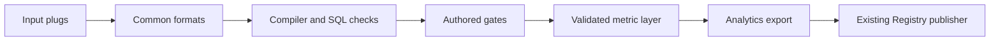

# Metrics engine pipeline

One run.yml describes inputs, source scope, dialect, verification and output. The plugin owns
the customer interview and creates the configuration from decisions already supplied.

## Execution

The runner resolves installed plugs, settles a history-only, BI-only or combined profile, and
executes the stages for that profile. It records progress in manifest.json and resumes from
the existing stage state. Input and reader packages convert vendor formats into common
artifacts; the core never special-cases a connector or destination.

History processing admits bounded analytical query shapes and produces witnessed statements.
BI processing parses definitions, creates question units, compiles formulas and witnesses
the resulting SQL. The two statement layers are merged before business descriptions and
metric judgments are authored.

## Authored gates

- A3b: review compiler output and propose rule rows. Never replace compiler SQL with model SQL.
- C3: author business questions from BI evidence.
- M2: describe each statement in the merged verified-query layer.
- X1: decide what business metrics, if any, each statement measures.
- X2: merge proposals without losing sources or changing mandatory populations.
- X3: author complete metric cards and validate their execution fields.
- X4: relate metrics, recording what each component contributes and where populations differ.

The runner writes a prompt bundle and pauses with exit 3. The operator's assistant reads the
corresponding skill, authors an answer, then resumes the runner. No engine stage calls a model
API. Refused answers return through the same validators. Compiler and card repair loops are
bounded, refuse regressions and retain accepted outputs.

## Output

The plugin selects publish: [files] and no observers. The validated bundle contains verified
queries, metric cards and metric relationships. It stays on disk. The Analytics adapter
projects that common bundle into the existing publication contract. Registry authentication,
publication, reconciliation and releases remain outside this engine.

## Quality and access

Read-only checks run before warehouse execution. Missing access can yield parse-only evidence;
a failed semantic check never becomes a successful witness. Coverage, blocked units, conversion
quality and source limitations stay explicit. Policy thresholds live in data/agent_policy.yml.
Every stage validates its artifacts against their schemas. No force or skip-gate flag exists.

